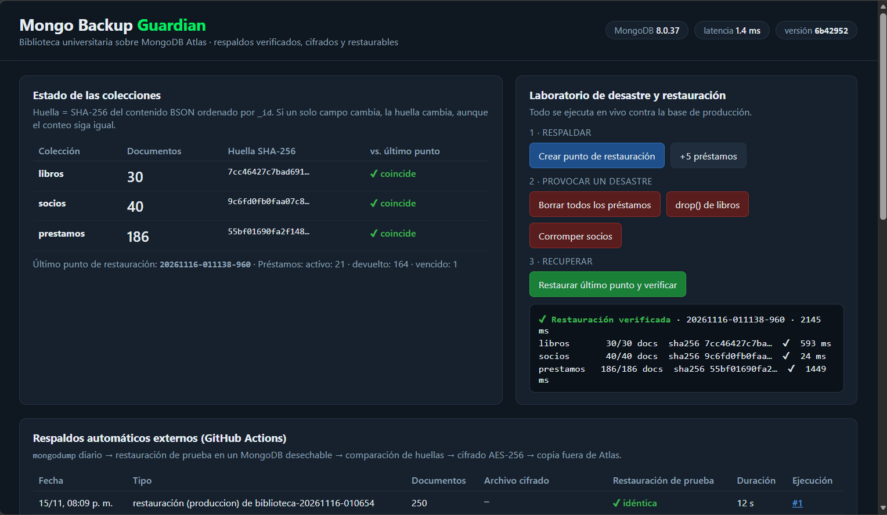
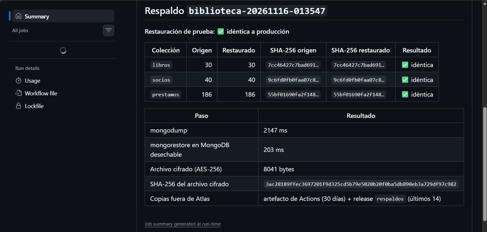
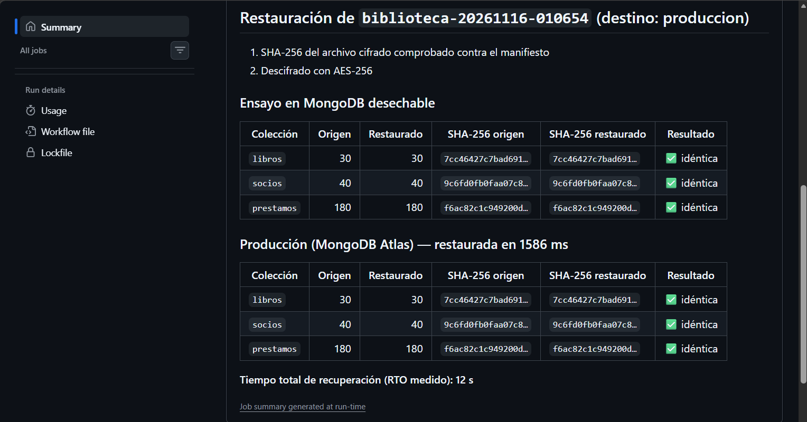
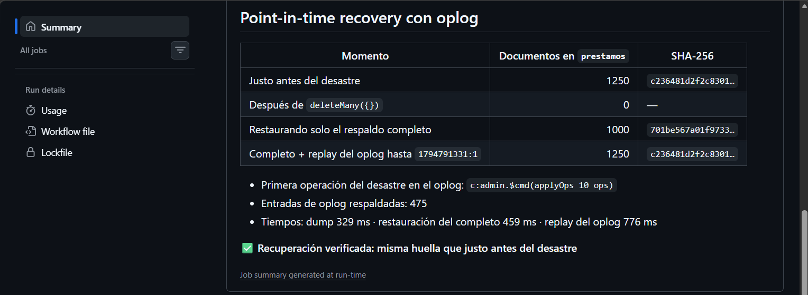
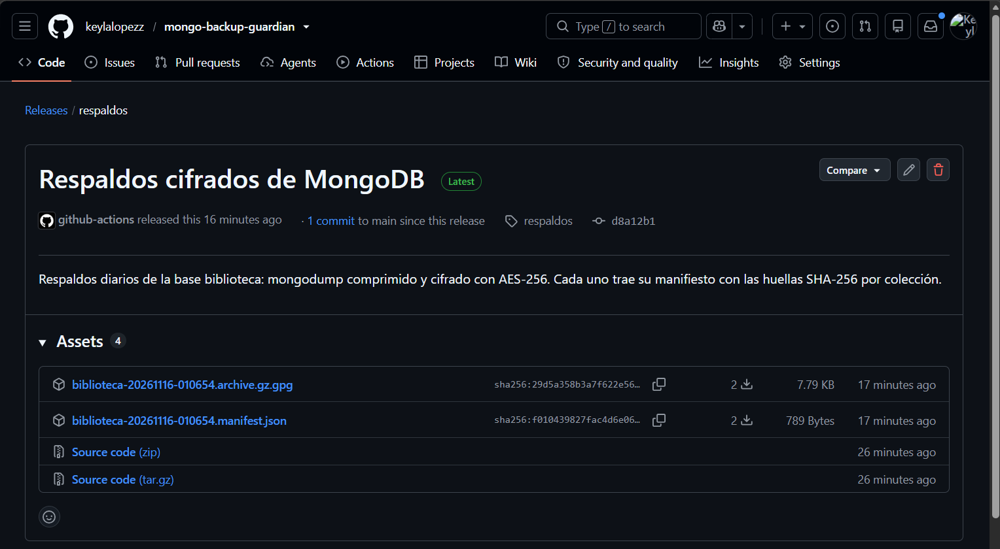
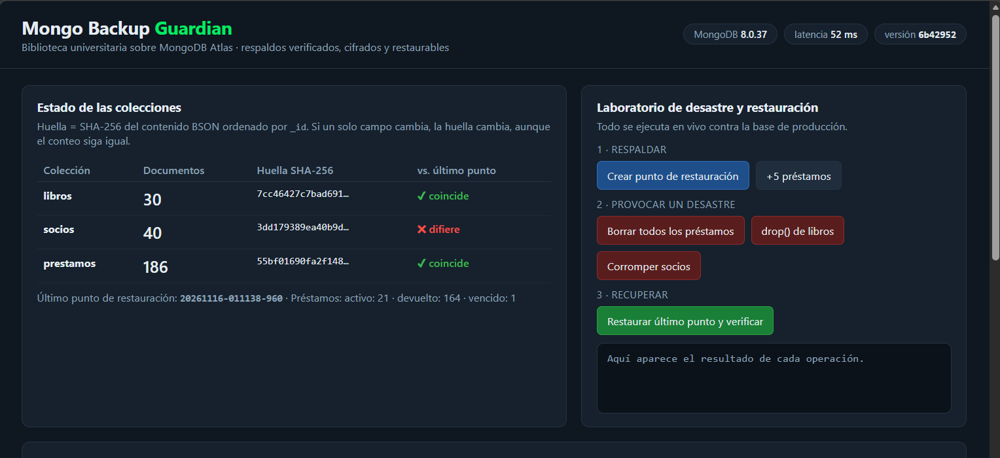
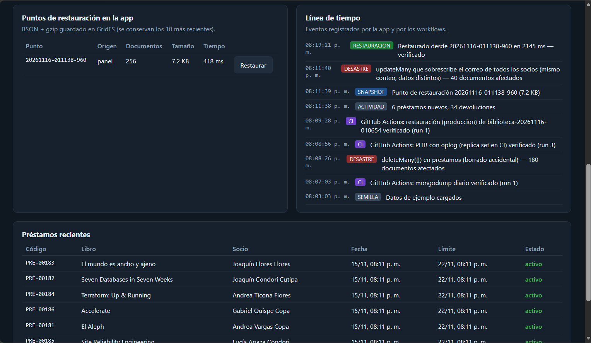
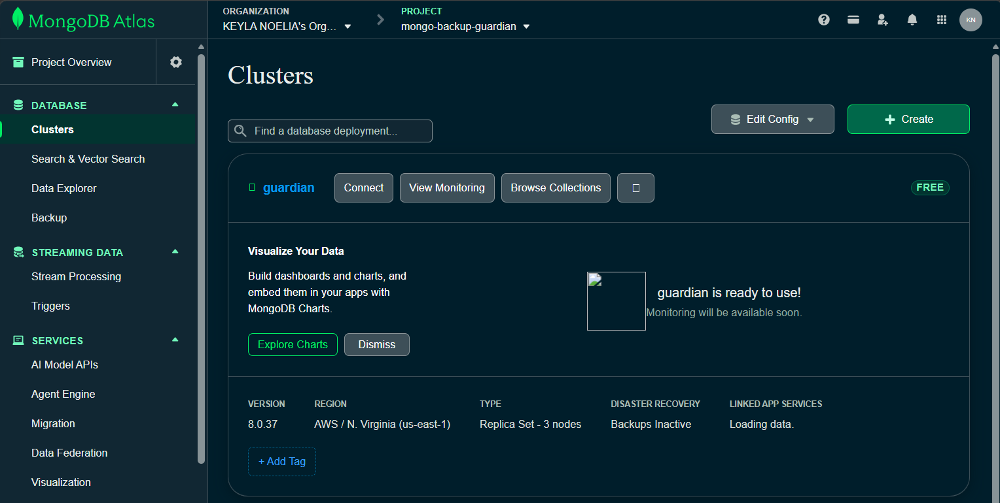
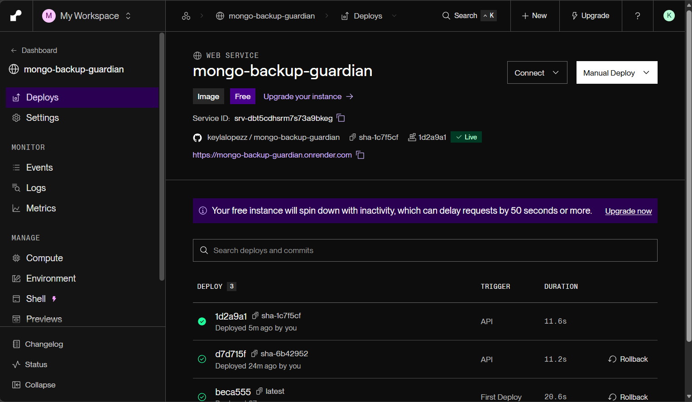

# Mongo Backup Guardian · Estrategia de respaldo NoSQL con MongoDB Atlas

[](https://github.com/keylalopezz/mongo-backup-guardian/actions/workflows/ci-cd.yml)
[](https://github.com/keylalopezz/mongo-backup-guardian/actions/workflows/infra.yml)
[](https://github.com/keylalopezz/mongo-backup-guardian/actions/workflows/backup.yml)
[](https://github.com/keylalopezz/mongo-backup-guardian/actions/workflows/pitr.yml)

Una biblioteca universitaria (libros, socios y préstamos) sobre **MongoDB Atlas** con una **estrategia de respaldo completa y verificable**: respaldos diarios automáticos con `mongodump`, **restauración de prueba en cada respaldo**, comparación de **huellas SHA-256** por colección, **cifrado AES-256**, copias **fuera del proveedor de la base**, **point-in-time recovery con oplog** y un **laboratorio de desastre y restauración** en vivo.

> Actividad grupal — Base de Datos II, Escuela Profesional de Ingeniería de Sistemas, Universidad Privada de Tacna.
> Autores: **Keyla Noelia Lopez Ojeda** y **Adrian Fabricio Salas Acuña**.

**App publicada:** https://mongo-backup-guardian.onrender.com



## Estrategia de respaldo

| Capa | Técnica | Frecuencia | Dónde vive | Verificación |
|---|---|---|---|---|
| Respaldo lógico completo | `mongodump --gzip --archive` con usuario **de solo lectura** | Diario (03:00 Lima) | Artefacto de Actions (30 días) + release `respaldos` (últimos 14), **cifrados AES-256** | Restauración en un MongoDB desechable y comparación de huellas SHA-256 |
| Point-in-time recovery | `mongodump --oplog` + respaldo de `local.oplog.rs` + `mongorestore --oplogReplay --oplogLimit` | Ensayo semanal | Replica set en CI | Huella igual a la de un instante antes del desastre |
| Puntos de restauración rápidos | BSON + gzip en **GridFS** desde la app | A demanda | Mismo clúster (no cuenta como copia externa) | Conteo + SHA-256 por colección al restaurar |
| Recuperación ante desastres | `restore.yml`: descarga → SHA-256 → descifra → ensayo → producción | A demanda | — | Huellas contra el manifiesto + RTO medido |

**Regla 3-2-1:** 3 copias (Atlas + artefacto de Actions + release), en 2 proveedores distintos (MongoDB Atlas/AWS y GitHub), 1 fuera del proveedor de la base de datos.

## Arquitectura

```
                       ┌─ ci-cd.yml   : pruebas con MongoDB 8.0 ─► imagen ghcr.io ─► deploy Render ─► verifica versión
git push / cron ──► GitHub Actions ─┼─ infra.yml   : Terraform ─► Atlas (proyecto, M0, usuarios, red) + Render
                       ├─ backup.yml  : mongodump ─► restore de prueba ─► SHA-256 ─► AES-256 ─► artefacto + release
                       ├─ restore.yml : release ─► SHA-256 ─► descifrar ─► ensayo ─► (producción)
                       └─ pitr.yml    : replica set ─► completo + oplog ─► desastre ─► replay hasta antes del desastre

Navegador ──► Render (ASP.NET Core 10) ──TLS──► MongoDB Atlas M0 (replica set de 3 nodos, AWS us-east-1)
```

| Pieza | Tecnología |
|---|---|
| Base de datos | MongoDB Atlas M0 (MongoDB 8), replica set administrado |
| API y panel | ASP.NET Core 10 (minimal API) + MongoDB C# Driver 3 |
| Hosting | Render Web Service (plan free) con la imagen de GitHub Packages |
| Infraestructura | Terraform: `mongodb/mongodbatlas`, `render-oss/render` |
| Respaldos | MongoDB Database Tools 100.x (`mongodump`, `mongorestore`), GnuPG AES-256, PyMongo |
| Automatización | GitHub Actions: `ci-cd`, `infra`, `backup`, `restore`, `pitr` |

## Huella de una colección

`conteo + SHA-256(BSON de cada documento, ordenado por _id)`. La calculan igual la app (C#) y `scripts/huella.py` (Python), así que se pueden comparar producción, la copia restaurada y lo que ve la app. Contar documentos no basta: una corrupción que sobrescribe campos mantiene el conteo, pero cambia la huella.

## API

| Método | Ruta | Descripción |
|---|---|---|
| GET | `/health` | Estado de la conexión con MongoDB |
| GET | `/api/info` | Versión (commit), versión de MongoDB y latencia |
| GET | `/api/estado` | Conteo y huella SHA-256 por colección, comparada con el último punto |
| POST | `/api/snapshots` | Crea un punto de restauración (BSON + gzip en GridFS) |
| POST | `/api/snapshots/{id\|ultimo}/restaurar` | Restaura y verifica conteo y huella |
| POST | `/api/desastre/{borrado-masivo\|drop-coleccion\|corrupcion}` | Simula un desastre |
| POST | `/api/actividad?n=5` | Registra préstamos nuevos |
| GET/POST | `/api/respaldos` | Respaldos registrados por GitHub Actions (POST con `X-Guardian-Token`) |
| GET | `/api/eventos` | Línea de tiempo |

## Ejecutar en local

```bash
docker run -d --name mongo -p 27017:27017 mongo:8.0
dotnet run --project src/Guardian                 # http://localhost:5000
MONGODB_URI=mongodb://localhost:27017 dotnet test # 11 pruebas contra MongoDB real
bash scripts/pitr.sh                              # demostración de PITR (requiere docker y pymongo)
```

## Secretos de GitHub Actions

| Secreto | Uso |
|---|---|
| `ATLAS_PUBLIC_KEY`, `ATLAS_PRIVATE_KEY`, `ATLAS_ORG_ID` | Terraform crea el proyecto y el clúster en Atlas |
| `MONGO_APP_PASSWORD` | Usuario `guardian-app` (lectura/escritura): la app y `restore.yml` en producción |
| `MONGO_BACKUP_PASSWORD` | Usuario `guardian-backup` (**solo lectura**): `backup.yml` |
| `MONGODB_HOST` | Host SRV del clúster (salida de Terraform) |
| `BACKUP_PASSPHRASE` | Cifra los respaldos con AES-256 |
| `TF_STATE_PASSPHRASE` | Cifra el estado de Terraform (el repositorio es público) |
| `GUARDIAN_TOKEN` | GitHub Actions registra sus respaldos en la app |
| `RENDER_API_KEY`, `RENDER_OWNER_ID`, `GHCR_TOKEN` | Crear y desplegar el Web Service |

## Evidencias

| Respaldo diario verificado | Recuperación ante desastres en producción |
|---|---|
|  |  |
| **Point-in-time recovery con oplog** | **Respaldos cifrados fuera de Atlas** |
|  |  |
| **Corrupción silenciosa detectada por la huella** | **Línea de tiempo de la app** |
|  |  |
| **MongoDB Atlas M0 (sin backups administrados)** | **Render** |
|  |  |
